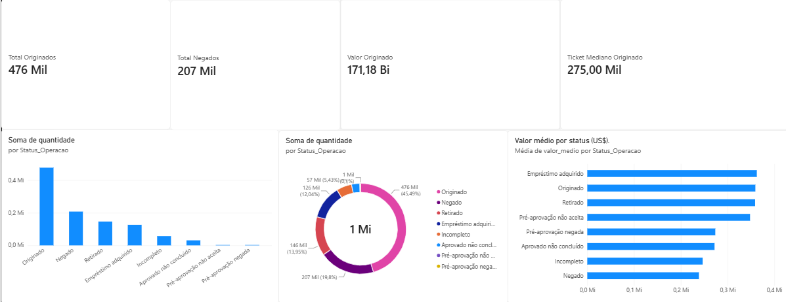

# 🏠 Mortgage Analytics — Análise de Financiamento Imobiliário

Projeto de análise de dados desenvolvido com Python, Pandas, SQL e Power BI, utilizando dados públicos de operações de financiamento imobiliário da Flórida (EUA), referentes a 2024.

## 🎯 Objetivo

Transformar dados brutos de operações imobiliárias em indicadores e visualizações que auxiliem na compreensão dos resultados das operações de crédito.

## 🛠️ Tecnologias utilizadas

- **Python e Pandas:** exploração, limpeza e transformação de dados.
- **Parquet:** armazenamento dos dados processados.
- **SQL e DuckDB:** consultas, agregações e análise de indicadores.
- **Power BI e DAX:** criação de KPIs e dashboard interativo.
- **Git e GitHub:** versionamento e documentação.

## 🔄 Etapas do projeto

1. Obtenção dos dados públicos do HMDA.
2. Exploração de mais de 1 milhão de registros.
3. Identificação de valores ausentes e padronização de tipos.
4. Tratamento de campos numéricos e valores especiais, como `Exempt`.
5. Armazenamento dos dados tratados em Parquet.
6. Análises SQL por status, tipo de empréstimo e região.
7. Construção de indicadores e visualizações no Power BI.

## 📊 Principais indicadores

| Indicador | Resultado |
|---|---:|
| Total de registros | 1.047.439 |
| Empréstimos originados | 476.451 |
| Solicitações negadas | 207.409 |
| Valor total originado | US$ 171,18 bilhões |
| Ticket mediano originado | US$ 275 mil |

## 📈 Dashboard



O dashboard apresenta a distribuição das operações por status, os valores médios e os principais indicadores de financiamento imobiliário.

## 💡 Principais insights

- Aproximadamente **45,5% dos registros** correspondem a empréstimos originados.
- Cerca de **19,8% dos registros** correspondem a solicitações negadas.
- O valor médio dos empréstimos originados é aproximadamente **US$ 359 mil**, superior ao das solicitações negadas, de aproximadamente **US$ 239 mil**.
- O ticket mediano dos originados é de **US$ 275 mil**, inferior à média, indicando influência de operações de maior valor.

Esses resultados são descritivos e não estabelecem relações de causa e efeito.

## 📁 Estrutura do repositório

```text
mortgage-analytics/
├── python/
│   ├── 01_exploracao.ipynb
│   ├── 02_exploracao.ipynb
│   └── 03_analise_sql.ipynb
├── powerbi/
│   └── Mortgage_Analytics.pbix
├── images/
│   └── dashboard.png
├── README.md
├── requirements.txt
└── .gitignore
```

## 📚 Fonte dos dados

Dados públicos do **Home Mortgage Disclosure Act (HMDA)**, referentes à Flórida em 2024.

Fonte: https://www.consumerfinance.gov/data-research/hmda/

**Observação:** a proporção de operações originadas em relação ao total de registros não deve ser interpretada diretamente como taxa de aprovação de solicitações.